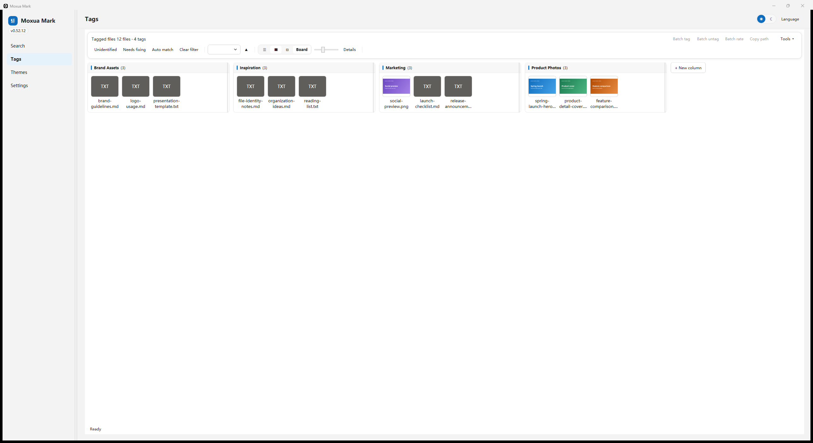

# Moxua Mark

### Tags that follow your files.

**A local-first Windows workspace for file tags, ratings and Markdown notes—designed to preserve your organization as files are renamed, moved and reorganized.**

[Official website](https://moxuamark.com/en/) · [简体中文](README_ZH.md) · [Download](https://github.com/mongxun/moxuamark-release/releases/latest) · [Quick start](#quick-start) · [Pricing](#pricing) · [Support](#releases-and-support)

[](https://github.com/mongxun/moxuamark-release/releases/latest)
[](https://github.com/mongxun/moxuamark-release/releases/latest)
[](https://dotnet.microsoft.com/)
[](#offline-activation-and-data-ownership)

> **Traditional tagging tools often remember where a file was. Moxua Mark remembers which file it is.**

## Why Moxua Mark?

Paths are convenient for opening files, but fragile as long-term identities. When a file is renamed or moved, a path-based library can quietly lose the tags, ratings and notes you spent time creating.

Moxua Mark adds a second layer of identity:

- **Same-drive changes**: NTFS `(VolumeSerial + FileId)` helps reconnect your existing organization after renames and supported moves.
- **Cross-drive recovery**: quick-hash content fingerprints help verify candidates instead of assuming that identical names and sizes mean the same file.
- **Your work remains yours**: the local SQLite library keeps tags, ratings, Markdown notes and preferences on your computer.

Recovery is **best-effort**, not a promise that every hardware, filesystem or database failure can be repaired. Regular backups remain essential.

## Moxua Mark vs. path-only tagging

| Scenario | Path-only organization | Moxua Mark |
|---|---|---|
| Rename a file on the same NTFS drive | The old association may break | File identity helps reconnect the existing record |
| Move a file to another folder | You may need to find and retag it | Supported moves can be followed automatically |
| Move a file to another drive | The old path no longer identifies it | Quick-hash fingerprints help verify recovery candidates |
| Build a lasting library | Folder discipline becomes a prerequisite for preserving work | File identity adds resilience when your structure changes |
| Work offline | Depends on the tool | Core organization and Pro activation work offline |

## What you can do today

### 🏷️ Build a flexible tagging workspace

- Create hierarchical tags and use board-based organization.
- Apply tags to files **and folders** without turning the folder into thousands of individual records.
- Filter, sort and page through larger libraries without loading the entire library into memory.
- Use multiple views and saved queries for different organization workflows.

### ⭐ Keep ratings and notes beside the file

- Use multiple rating systems for different kinds of collections.
- Write Markdown notes for decisions, usage instructions, provenance or creative context.
- Preserve tags, ratings and notes as part of the same persistent file record.

### 🔎 Find and recover files

- Search your library and organize what you find.
- Optionally connect **Everything** for fast file-name search and directory enumeration.
- Use file identity and content fingerprints to help recover organization after supported file movements.

> Everything is **optional but highly recommended**. Moxua Mark can fall back to slower disk enumeration. Everything helps find files; Moxua Mark organizes what happens next.

### 💾 Keep control of your data

- A single local SQLite library—no Moxua account is required.
- Built-in backup tools and clear data-location controls.
- No application telemetry, advertising SDK or account-based lock-in.
- The app does not upload your files, file names, tags, ratings or notes.

### 🌍 Use the product in your language

The application includes Simplified Chinese, English, Japanese and Korean resources. The installer provides complete Simplified Chinese and English flows, including license terms and data-preservation messages.

## Who is it for?

- **Creators and designers**: track source files, variants, usage notes and publication status.
- **E-commerce sellers**: organize product images, listing assets, revisions and channel-specific notes.
- **Researchers and writers**: keep references, annotations and ratings attached to evolving document libraries.
- **Photographers and video editors**: preserve organization while moving projects between folders and NTFS drives.
- **Anyone with a growing local library**: organize files without being forced into one permanent folder hierarchy.

## Tags and board workspace



A clean overview of a file library, organized into **Brand Assets, Inspiration, Marketing and Product Photos**. Each group makes the next step obvious: browse campaign assets, open a file for details, or adjust the card-size slider to switch between compact scanning and larger visual previews.

Tags, ratings and notes stay attached to the file record, so this organization is designed to survive supported renames and moves rather than depending on one permanent folder hierarchy.

*Example only: every file and tag shown is fictional demo data, captured with the English interface. No personal library information is included.*

## A note from the author

For years, I wanted a file manager that matched how I actually work. I tried many tools: some were powerful but felt bulky and demanding, while others lost the organization I had built as soon as a file was renamed or moved.

So I decided to build one myself. Moxua Mark started as something I made for my own use. Over time, I realized that other people might have the same frustration, so I kept refining it into something I could share.

The Free tier is intended to be genuinely useful on its own. Pro is there for people with larger libraries, and sponsorship is entirely optional. Independent development takes time, and AI-assisted development has become a real cost. If Moxua Mark helps you, buying Pro or buying me a coffee would help cover those costs and give me the energy to keep improving it. Either way, thank you for giving it a try.

## Quick start

### 1. Download Moxua Mark

Download the latest Windows x64 installer from [GitHub Releases](https://github.com/mongxun/moxuamark-release/releases/latest).

Each release provides release notes and a SHA256 checksum. On Windows, you can verify the installer with:

```powershell
Get-FileHash .\MoxuaMark-<version>-setup.exe -Algorithm SHA256
```

Compare the result with the checksum published on the release page.

### 2. Install

- Runs on **Windows 10 / 11 x64**.
- Installs for the current user—no administrator installation is required.
- The installer offers Simplified Chinese and English.
- **Everything is highly recommended**: the installer can open its official download page, but never installs it silently.

### 3. Add files and organize

1. Add files or folders from the search page, or scan a directory.
2. Create tags and add ratings or Markdown notes.
3. Use boards, filters and saved queries to build your own workflow.
4. Create a backup from the data settings.

### 4. Upgrade when you need a larger library

The Free tier lets you evaluate the complete current workflow. Pro removes the file and folder count limit while keeping offline activation and local data ownership.

## Offline activation and data ownership

- Pro activation uses a signed license verified locally by the app.
- Ordinary use does not require a Moxua account or an ongoing licensing connection.
- If optional online license management is enabled, activation or deactivation sends only the license code and a random installation ID—not a hardware fingerprint.
- Update checks retrieve public version metadata only when initiated.
- Your local license record is protected with DPAPI CurrentUser encryption.

## Pricing

| Edition | Early-bird price | Regular price | Included |
|---|---:|---:|---|
| **Free** | $0 / ¥0 | $0 / ¥0 | Current core features, up to 300 files and folders per library, unlimited tags |
| **Pro** | **$8.99 / ¥49** | **$14.99 / ¥99** | Unlimited files and folders, one-time purchase, offline activation, major-version updates |

Only new entries are blocked after the free limit is reached; existing data remains viewable, editable and exportable.

**Checkout is coming soon.** Purchase links will be enabled only after real payment, delivery, refund/reissue and settlement flows pass acceptance. Sponsorship is voluntary and does not include a Pro license.

## Roadmap

### Near term: a more complete file-management workflow

Continued improvements to browsing, batch organization, search, automation and long-term file tracking.

### Optional model capabilities—planned

Assisted tagging, semantic search, intelligent classification and summaries are development directions, not current features. Any future external model service will be explained separately and will require explicit consent.

### Long-term vision

Explore a file-organization layer built on identity, tags, relationships and intelligent retrieval rather than fixed folder hierarchies alone.

Roadmap items are directions, not promised release dates or features included in the current download.

## Privacy and security

- Your library stays on your PC in a local SQLite database.
- No Moxua account, application telemetry, advertising or usage-analytics SDK.
- No file names, file paths, notes or file contents are sent to Moxua during ordinary use.
- Network access is limited to user-initiated downloads, update checks, purchases and optional online license-management actions.
- This release repository contains official installers and update metadata only—no private source tree, user library, private keys or customer records.

Read the [Privacy Policy](https://moxuamark.com/en/legal/privacy/) for the complete current policy.

## Releases and support

- [Latest release](https://github.com/mongxun/moxuamark-release/releases/latest)
- [Official website](https://moxuamark.com/en/)
- [Terms and Conditions](https://moxuamark.com/en/legal/terms/)
- [Privacy Policy](https://moxuamark.com/en/legal/privacy/)
- [Refund Policy](https://moxuamark.com/en/legal/refund/)
- Product and licensing support: **support@moxuamark.com**

Use GitHub Issues for reproducible bugs, installation problems and feature requests. Do not attach your library, license code, private order link or personal documents.

## FAQ

### Is Moxua Mark open source?

No. This repository is the official release and update-metadata channel. The application source is private; installers and public release notes are provided here.

### Is Everything required?

No, but it is highly recommended for fast file-name search and directory enumeration. Moxua Mark retains a slower disk-enumeration fallback.

### Do I need an account or a subscription?

No Moxua account is required. Pro is a one-time purchase, not a subscription.

### Does Pro activation require an internet connection?

No. Offline activation is supported. Optional online license management is separate and can be used for installation-slot management.

### Does it work on every drive?

Real-time file-identity tracking requires NTFS. Cross-drive recovery uses content fingerprints and is best-effort rather than a guarantee.

### Is the Free tier a time-limited trial?

No. It includes current core features with a limit of 300 files and folders per library and unlimited tags.

### Does sponsorship include Pro?

No. Sponsorship is voluntary support for development and is separate from purchasing a Pro license.

---

**Moxua Mark · Tags that follow your files.**
