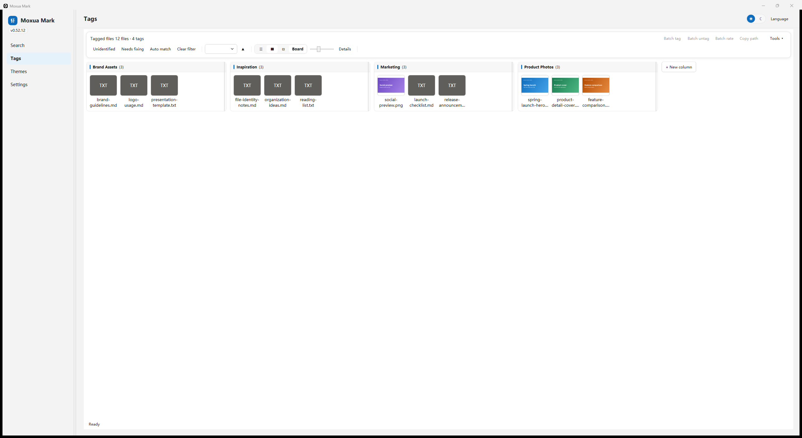

# Moxua Mark

### 文件挪窝，标签不丢。

**一款本地优先的 Windows 文件标签工具：用文件身份与内容指纹，在文件改名、移动和重新整理后，帮助你保留标签、评分与 Markdown 备注。**

[中文官网](https://moxuamark.com/zh/) · [English](README.md) · [下载](https://github.com/mongxun/moxuamark-release/releases/latest) · [快速开始](#快速开始) · [价格](#价格) · [支持开发](#支持开发)

> 传统标签工具往往记住的是“文件在哪里”；Moxua Mark记住的是“它是谁”。

## 为什么需要Moxua Mark？

路径适合打开文件，却不适合作为长期身份。文件改名、移动或跨盘整理后，基于路径建立的标签库可能悄然失效，你之前投入的标签、评分和备注也会难以找回。

Moxua Mark在路径之外增加两层身份：

- **同盘改名与移动**：通过 NTFS `(VolumeSerial + FileId)` 文件身份，帮助续接原有整理记录；
- **跨盘恢复**：使用 quick hash 内容指纹核对候选文件，而不是把同名同大小当成同一个文件；
- **数据始终由你掌握**：标签、评分、Markdown 备注和偏好保存在本机 SQLite 数据库中。

恢复能力按尽力而为提供，不能保证解决所有硬件、文件系统或数据库故障。定期备份仍然必要。

## 与普通路径型标签工具的区别

| 使用场景 | 仅按路径关联 | Moxua Mark |
|---|---|---|
| 同盘改名 | 原有关联可能失效 | 通过文件身份帮助续接 |
| 移动到其他文件夹 | 可能需要重新搜索和打标 | 支持的移动可自动跟随 |
| 跨盘整理 | 旧路径不再能证明文件身份 | 用内容指纹辅助核对恢复候选 |
| 长期积累 | 必须维持固定目录结构才能保住整理成果 | 文件身份为目录调整增加韧性 |
| 离线使用 | 取决于具体工具 | 核心整理和 Pro 激活均可离线完成 |

## 当前版本能做什么

### 🏷️ 标签与看板

- 创建层级标签，使用看板组织文件；
- 文件和文件夹都能打标签，拖入文件夹时默认作为一条整体记录；
- 支持筛选、排序、分页、视图切换与保存查询；
- 免费限额按全库文件与文件夹条目计算，设置页同时显示其中已打标签数量。

### ⭐ 评分与 Markdown 备注

- 支持多套评价体系；
- 记录用途、来源、决策、版本差异和使用说明；
- 标签、评分与备注共同归属于持续的文件记录。

### 🔎 搜索与恢复

- 搜索库内文件，并继续完成整理；
- 可选连接 **Everything**，获得更快的文件名搜索和目录枚举；
- 文件移动后，使用身份与内容指纹辅助恢复整理成果。

> Everything **不是必需，但非常推荐**。没有它时，Moxua Mark可以退回较慢的磁盘枚举。Everything 帮你找到文件，Moxua Mark负责找到之后的组织与长期追踪。

### 💾 本地数据与备份

- 本地 SQLite 单库，无需 Moxua 账号；
- 提供备份工具与数据位置管理；
- 无应用遥测、广告 SDK 或账号绑定；
- 不上传文件、文件名、标签、评分或备注。

### 🌍 多语言

应用支持简体中文、English、日本語和 한국어。安装器提供完整的中英文流程，包括许可协议与卸载数据保留说明。

## 适合哪些人？

- **自媒体与设计师**：管理素材、版本、使用说明和发布状态；
- **电商卖家**：整理商品图片、详情素材、修改记录和渠道备注；
- **研究与写作者**：保存参考文献、批注、评分和长期笔记；
- **摄影与视频创作者**：在项目移动和硬盘整理后继续保留组织成果；
- **所有本地文件不断增多的人**：不必为了保住标签而永远维持同一套目录结构。

## 标签与看板工作区



素材按 **品牌资产、灵感、营销和产品图片** 分组，一眼就能看清归属。需要快速浏览时缩小卡片，需要查看画面细节时拖大缩放滑杆即可；不必逐个打开文件，也能保持工作区整洁、重点明确。

标签、评分和备注始终归属于文件记录，因此这套整理方式不会把成果锁死在某一套固定目录结构中，而是为支持的改名和移动场景提供持续关联。

*图中全部是虚构演示数据，不包含个人文件或真实标签库信息。*

## 作者的话

多年以来，我一直想找一款真正适合自己的文件管理软件。试过不少工具：有些功能很多，但体积臃肿、操作繁重；还有些在文件改名或移动之后，就让我再也找不回之前的整理成果。

于是，我决定自己做一款。最初只是打算给自己用，做着做着，又觉得也许很多人都有同样的困扰，便继续完善，把它分享出来。

免费版已经可以认真使用，我也希望它对大多数人来说足够好用。需要更大容量的朋友可以选择 Pro；如果你觉得Moxua Mark帮到了你，也可以请我喝杯咖啡。现在 AI 辅助开发的成本不低，你的支持会帮我分担这些费用，也会成为我继续完善它的动力。无论是否付费或赞助，都谢谢你愿意尝试。

## 快速开始

### 1. 下载

从 [Gitee Release（国内镜像）](https://gitee.com/scotttttttmr/moxuamark-release/releases/latest) 或 [GitHub Releases（主源）](https://github.com/mongxun/moxuamark-release/releases/latest) 下载最新 Windows x64 安装包。两个渠道的同名安装包应具有一致的 SHA-256。

每个版本应提供发布说明和 SHA256。可在 PowerShell 中核对：

```powershell
Get-FileHash .\MoxuaMark-<版本>-setup.exe -Algorithm SHA256
```

### 2. 安装

- 支持 **Windows 10 / 11 x64**；
- 当前用户安装，默认不需要管理员权限；
- 安装器支持中文和 English；
- 安装后推荐打开 Everything 官方下载页，但**不会捆绑或静默安装**。

### 3. 开始整理

1. 从搜索页添加文件或文件夹，或扫描目录；
2. 创建标签，添加评分和 Markdown 备注；
3. 用看板、筛选和保存查询形成自己的工作流；
4. 在数据设置中创建备份。

### 4. 需要更大容量时升级 Pro

免费版可认真体验当前完整流程。Pro 解除文件与文件夹数量限制，同时保留离线激活和本地数据所有权。

## 离线激活与数据所有权

- Pro 使用签名激活码，由应用在本地验签；
- 日常使用不需要 Moxua 账号或持续授权连接；
- 可选在线授权管理只处理激活码和随机安装 ID，不采集硬件指纹；
- 只有主动检查更新时才获取公开版本元数据；
- 本机激活记录使用 DPAPI CurrentUser 加密保护。

## 价格

| 版本 | 早鸟价 | 正价 | 包含内容 |
|---|---:|---:|---|
| **免费版** | ¥0 / $0 | ¥0 / $0 | 当前核心功能，单库最多 300 个文件与文件夹，标签数量不限 |
| **Pro** | **¥49 / $8.99** | **¥99 / $14.99** | 文件与文件夹数量不限，一次买断，离线激活，包含大版本更新 |

免费版超限后只阻止新增，已有数据仍可查看、编辑和导出。

**购买尚未开放。** 正式付款、交付、退款/换发与结算验收通过后再开启购买链接。赞助属于自愿支持，不包含 Pro 授权。

## 赞助支持

如果 Moxua Mark 对你有帮助，可以[通过爱发电支持继续开发](https://afdian.com/a/moxua)。赞助完全自愿，不赠送 Pro，不改变免费版限制，也不包含额外功能权益。

爱发电的付款与结算记录只保存在爱发电后台，不会显示为 GitHub Sponsors 的赞助人数、头像或付款记录。海外 Ko-fi 赞助渠道将在账户与结算验收完成后开放。

## 持续开发方向

### 近期：更完整的文件管理工作流

持续改进文件浏览、批量整理、搜索、自动化与长期追踪。

### 可选模型能力：规划中

辅助打标、语义搜索、智能归类和摘要属于开发方向，不是当前版本功能。未来如涉及外部模型服务，会单独说明并征得明确同意。

### 长期愿景

逐步探索以文件身份、标签、关系和智能检索为基础、超越固定目录层级的文件组织层。

路线图不代表承诺的发布时间，也不代表当前安装包已经包含这些能力。

## 隐私与安全

- 标签库保存在本机 SQLite 数据库；
- 无 Moxua 账号、应用遥测、广告或使用统计 SDK；
- 日常使用中，不向 Moxua 发送文件名、路径、备注或文件内容；
- 网络仅用于你主动进行的下载、更新检查、购买和可选在线授权操作；
- 本仓库只提供官方安装包和更新元数据，不包含私有源码、用户标签库、私钥或客户记录。

完整说明见[隐私声明](https://moxuamark.com/zh/legal/privacy/)。

## 下载、法务与支持

- [最新版本](https://github.com/mongxun/moxuamark-release/releases/latest)
- [中文官网](https://moxuamark.com/zh/)
- [用户协议](https://moxuamark.com/zh/legal/terms/)
- [隐私声明](https://moxuamark.com/zh/legal/privacy/)
- [退款政策](https://moxuamark.com/zh/legal/refund/)
- 产品与授权支持：**support@moxuamark.com**

GitHub Issues 可用于可复现的故障、安装问题和功能建议。请不要附上标签库、激活码、私密订单链接或个人文件。

## 常见问题

### Moxua Mark是开源软件吗？

不是。本仓库是官方发布与更新元数据渠道，应用源码保持私有，这里提供安装包和公开发布说明。

### Everything 必须安装吗？

不是必须，但非常推荐。没有 Everything 时仍可退回较慢的磁盘枚举。

### 需要账号或订阅吗？

不需要 Moxua 账号。Pro 是一次性买断，不是订阅。

### Pro 激活必须联网吗？

不需要。离线激活可用；可选在线授权管理是独立的安装位管理功能。

### 所有硬盘都能追踪吗？

实时文件身份追踪依赖 NTFS。跨盘恢复使用内容指纹，按尽力而为提供。

### 免费版是限时试用吗？

不是。免费版包含当前核心功能，单库最多 300 个文件与文件夹，标签数量不限。

### 赞助会赠送 Pro 吗？

不会。赞助是自愿支持开发，与购买 Pro 完全分开。

---

**Moxua Mark · 文件挪窝，标签不丢。**
